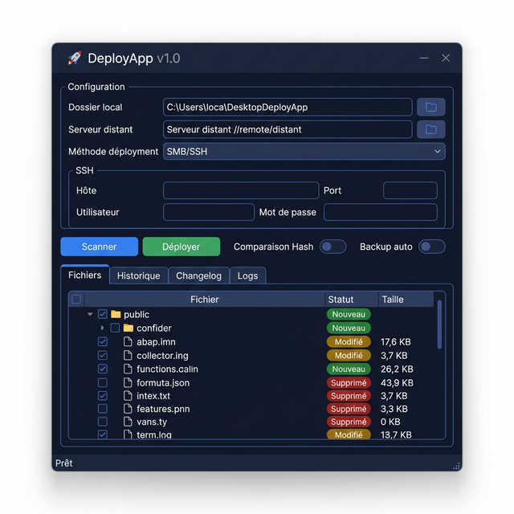
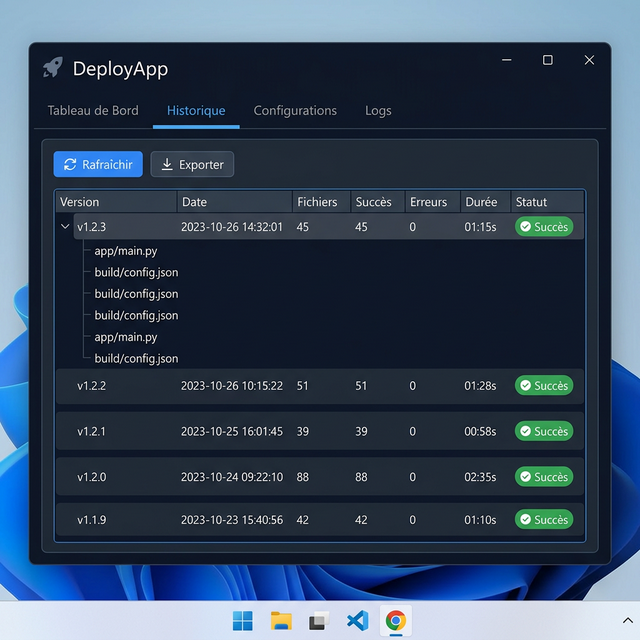
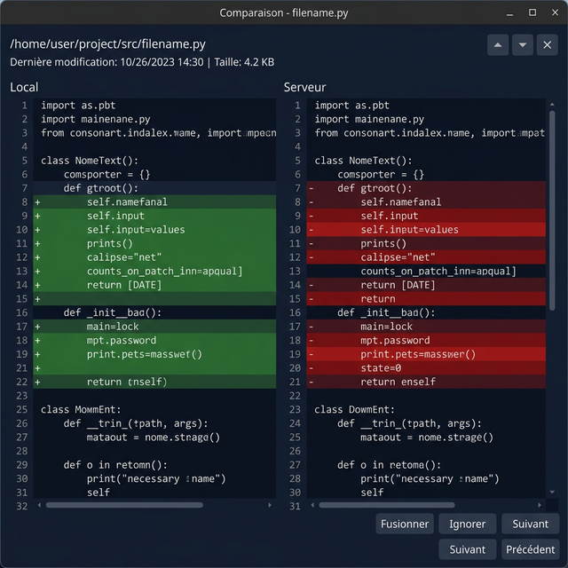

<p align="center">
  
</p>

<h1 align="center">🚀 DeployApp</h1>

<p align="center">
  <strong>A modern, visual deployment tool for Windows — deploy files via SMB or SSH/SFTP with a beautiful dark UI.</strong>
</p>

<p align="center">
  
  
  
  
  
</p>

---

## ✨ Features

| Feature | Description |
|---------|-------------|
| 🔍 **Smart File Scanning** | Compares local and remote files by size, timestamp, or MD5 hash |
| 📂 **Dual Deploy Methods** | Deploy via **SMB** (network share) or **SSH/SFTP** |
| 🎨 **Modern Dark UI** | Sleek Slate & Indigo theme with smooth animations |
| 📝 **Visual Diff** | Side-by-side file comparison for modified files |
| 📊 **Deployment History** | Full SQLite-backed history with changelog tracking |
| 🔄 **Server Restart** | One-click Waitress + Nginx restart via SSH |
| 💾 **Database Backup** | Automated MariaDB/MySQL backup with NAS replication |
| ⚡ **Multi-threaded** | Parallel file scanning and deployment for speed |
| 🎯 **Flexible Exclusions** | Configurable ignore patterns (like `.gitignore`) |
| 📋 **Version Management** | SemVer versioning with auto-increment |
| 🔧 **100% Configurable** | All settings in `deploy_config.json` — zero hardcoded values |

---

## 📸 Screenshots

<p align="center">
  
  <br/><em>Main View — File scanning with status badges (New, Modified, Deleted)</em>
</p>

<p align="center">
  
  <br/><em>Deployment History — Track every deployment with detailed logs</em>
</p>

<p align="center">
  
  <br/><em>Visual Diff — Side-by-side file comparison</em>
</p>

> 💡 *These are mockup previews. Replace with real screenshots by running the app and pressing `Win+Shift+S`.*

---

## 🚀 Quick Start

### Prerequisites

- **Python 3.10+**
- **Windows** (SMB paths and scheduled tasks are Windows-specific)

### Installation

```bash
# Clone the repository
git clone https://github.com/bjyoucef/DeployApp.git
cd DeployApp

# Create a virtual environment
python -m venv .venv
.venv\Scripts\activate

# Install dependencies
pip install -r requirements.txt

# Copy the example config and edit with your settings
copy deploy_config.example.json deploy_config.json

# Run the app
python main.py
```

---

## ⚙️ Configuration

All settings are stored in `deploy_config.json`. Copy `deploy_config.example.json` to get started:

```bash
copy deploy_config.example.json deploy_config.json
```

### Main Settings

| Key | Type | Description |
|-----|------|-------------|
| `local_dir` | `string` | Path to your local project directory |
| `remote_dir` | `string` | SMB network path (e.g., `\\192.168.1.10\Share`) |
| `deploy_method` | `"smb"` or `"ssh"` | Deployment protocol |
| `use_hash_comparison` | `bool` | Use MD5 hash instead of size/timestamp |
| `auto_backup` | `bool` | Backup files before overwriting |
| `ignore_patterns` | `string[]` | Glob patterns to exclude from scanning |

### SSH Settings

| Key | Type | Description |
|-----|------|-------------|
| `ssh_host` | `string` | SSH server hostname or IP |
| `ssh_port` | `int` | SSH port (default: `22`) |
| `ssh_user` | `string` | SSH username |
| `ssh_password` | `string` | SSH password |
| `ssh_key_path` | `string` | Path to private key (optional) |
| `ssh_remote_dir` | `string` | Remote directory on the server |

### Server Management (`server` section)

| Key | Type | Description |
|-----|------|-------------|
| `app_port` | `int` | Application port (default: `8080`) |
| `app_entry` | `string` | WSGI entry point (e.g., `app:app`) |
| `waitress_threads` | `int` | Number of Waitress worker threads |
| `task_name` | `string` | Windows scheduled task name |
| `use_nginx` | `bool` | Enable Nginx reload after deploy |
| `nginx_reload_cmd` | `string` | Command to reload Nginx |

### Database Backup (`backup` section)

| Key | Type | Description |
|-----|------|-------------|
| `backup_dir` | `string` | Local backup directory |
| `backup_nas_dir` | `string` | NAS backup replication path |
| `mysqldump_path` | `string` | Path to `mysqldump` executable |
| `db_user` | `string` | Database username |
| `db_password` | `string` | Database password |
| `retention_days` | `int` | Days to keep old backups |

---

## 📖 Usage

### 1. Scan Files
Click **"🔍 Scanner"** to compare your local project with the remote server. Files are classified as:
- 🟢 **Nouveau** — New file (exists locally but not on server)
- 🟡 **Modifié** — Modified file (content differs)
- 🔴 **Supprimé** — Deleted file (exists on server but not locally)

### 2. Review Changes
- Click on a modified file to see a **visual diff**
- Use checkboxes to select/deselect files for deployment
- Right-click for context menu options (exclude patterns, open file, etc.)

### 3. Deploy
Click **"🚀 Déployer"** to push selected files to the server. The app will:
- Copy new and modified files
- Delete removed files (with confirmation)
- Show real-time progress with detailed logs

### 4. Server Management (SSH only)

- **🔄 Restart Server** — Kills the running process, recreates the Windows scheduled task, and optionally reloads Nginx
- **💾 Backup Database** — Runs `mysqldump` on the server, compresses to ZIP, replicates to NAS

### 5. 🎯 File & Folder Exclusions

DeployApp includes a powerful exclusion system that works like `.gitignore`. You can manage it in two ways:

**Via the Exclusion Dialog (☰ button):**

- Opens a checklist of all known exclusion patterns
- Toggle each pattern on/off with checkboxes
- Add custom patterns (e.g. `*.log`, `temp/`, `uploads/*.tmp`)
- Patterns apply immediately to the next scan

**Via Right-Click Context Menu:**

- Right-click any file or folder in the scan results
- Select **"Ajouter une exclusion"** to create a pattern for it
- The pattern is saved to your config and persists across sessions

**How patterns work:**

| Pattern | What it excludes |
|---------|------------------|
| `__pycache__` | Any directory named `__pycache__` at any depth |
| `.git` | The `.git` directory |
| `*.pyc` | All compiled Python files |
| `node_modules` | Node.js dependencies |
| `.env` | Environment files |
| `dist` | Build output directories |

Patterns are stored in two config arrays:

- `all_ignore_patterns` — Master list of all known patterns (the full checklist)
- `ignore_patterns` — Only the currently **active** (checked) patterns

### 6. 📋 Version Management (SemVer)

DeployApp tracks your project version using the **Semantic Versioning** standard (`MAJOR.MINOR.PATCH`):

- A `VERSION` file is maintained in your local project directory
- Before each deployment, you can **bump** the version:
  - **Patch** (1.0.0 → 1.0.1) — Bug fixes, small changes
  - **Minor** (1.0.1 → 1.1.0) — New features, non-breaking changes
  - **Major** (1.1.0 → 2.0.0) — Breaking changes, major overhauls
- The version is displayed in the UI header and recorded in the deployment history
- After deployment, the updated `VERSION` file is also deployed to the server

### 7. 📊 Deployment History (SQLite)

Every deployment is automatically recorded in a local SQLite database (`deploy_history.db`). The **"Historique"** tab shows:

| Column | Description |
|--------|-------------|
| **Version** | The SemVer version at the time of deployment |
| **Date** | Timestamp of the deployment |
| **Fichiers** | Number of files deployed |
| **Succès** | Count of successfully transferred files |
| **Erreurs** | Count of failed transfers |
| **Durée** | Total deployment duration |
| **Changelog** | User-entered description of what changed |

Features:

- 🔍 Click any row to see the **full list of deployed files**
- 📄 Each deployment can have a **changelog message** describing the changes
- 🗑️ Old entries can be deleted individually
- The database is stored locally and excluded from git (`.gitignore`)

### 8. 📤 Export (Markdown & CSV)

Deployment history can be exported in two formats for documentation or auditing:

**Markdown Export (`.md`):**

- Generates a formatted changelog document
- Includes version, date, file list, and changelog notes
- Perfect for pasting into your project's `CHANGELOG.md` or wiki
- Example output:
  ```markdown
  ## v1.2.3 — 2025-03-14 14:30
  ### Fichiers déployés (15 fichiers)
  - ✅ app/routes.py
  - ✅ templates/index.html
  - ❌ static/old_style.css (supprimé)
  ### Notes
  Fix billing logic and update dashboard
  ```

**CSV Export (`.csv`):**

- Tabular format with all deployment metadata
- Opens directly in Excel, Google Sheets, or any spreadsheet tool
- Columns: Version, Date, Files Count, Success, Errors, Duration, Changelog
- Useful for compliance reports or deployment auditing

---

## 🏗️ Architecture

```
DeployApp/
├── main.py                      # Main application (single-file architecture)
├── deploy_config.json           # Your configuration (git-ignored)
├── deploy_config.example.json   # Example config template
├── deploy_history.db            # SQLite deployment history (git-ignored)
├── requirements.txt             # Python dependencies
├── icon.png                     # Application icon
├── icon.ico                     # Windows icon
├── screenshots/                 # App screenshots
├── LICENSE                      # MIT License
└── .gitignore                   # Git ignore rules
```

### Key Classes

| Class | Purpose |
|-------|---------|
| `DeployApp` | Main window — UI, scan/deploy orchestration |
| `ConfigManager` | Load/save `deploy_config.json` |
| `SSHDeployer` | SSH/SFTP connection and file operations |
| `FileComparator` | Compare files by size, timestamp, or hash |
| `HistoryManager` | SQLite deployment history and changelogs |
| `VersionManager` | SemVer version file management |
| `DiffDialog` | Visual side-by-side file diff viewer |
| `IgnorePatternsDialog` | Manage file exclusion patterns |
| `AnimatedToggle` | Custom animated toggle switch widget |

---

## 🤝 Contributing

Contributions are welcome! Here's how to get started:

1. **Fork** the repository
2. **Create** a feature branch: `git checkout -b feature/my-feature`
3. **Commit** your changes: `git commit -m "Add my feature"`
4. **Push** to the branch: `git push origin feature/my-feature`
5. **Open** a Pull Request

### Ideas for Contributions
- 🐧 Linux/macOS support (replace Windows-specific paths and commands)
- 🌐 Multi-language UI (i18n)
- 📦 PyInstaller packaging script
- 🔒 SSH key-based authentication improvements
- 📊 Deployment statistics dashboard
- 🔔 Desktop notifications on deploy completion
- 🎨 Theme customization (light mode, custom colors)
- 📝 Built-in code editor for quick fixes before deploy

---

## 📄 License

This project is licensed under the MIT License — see the [LICENSE](LICENSE) file for details.

---

## 🇫🇷 Français

**DeployApp** est un outil de déploiement visuel pour Windows. Il permet de scanner, comparer et déployer des fichiers vers un serveur via **SMB** (partage réseau) ou **SSH/SFTP**, avec une interface moderne et élégante.

### Installation rapide

```bash
git clone https://github.com/bjyoucef/DeployApp.git
cd DeployApp
python -m venv .venv
.venv\Scripts\activate
pip install -r requirements.txt
copy deploy_config.example.json deploy_config.json
# Éditez deploy_config.json avec vos paramètres
python main.py
```

### Fonctionnalités principales
- 🔍 Scan intelligent des fichiers (taille, date, hash MD5)
- 📂 Déploiement via SMB ou SSH/SFTP
- 📝 Comparaison visuelle (diff) des fichiers modifiés
- 📊 Historique complet des déploiements (SQLite)
- 🔄 Redémarrage serveur en un clic (Waitress + Nginx)
- 💾 Backup automatique de la base de données
- 🔧 Configuration flexible via `deploy_config.json`

---

<p align="center">
  Made with ❤️ using Python & PyQt6
</p>
